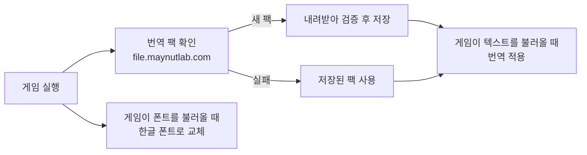

# 아스트랄 파티 한글패치

[](https://github.com/maynut02/astral-party-korean-plugin/releases/latest)
[](https://github.com/maynut02/astral-party-korean-plugin/releases)
[](LICENSE)

Steam판 **아스트랄 파티(Astral Party)** 를 한국어로 플레이할 수 있게 해 주는 [BepInEx](https://github.com/BepInEx/BepInEx) 플러그인입니다.

게임 파일을 수정하지 않습니다. 게임이 텍스트와 폰트를 불러오는 순간에 번역과 한글 폰트를 적용하므로, 게임이 업데이트되어도 플러그인을 다시 설치할 필요가 없습니다.

> 개발사와 관계없는 비공식 팬 번역입니다.

## 특징

- **게임 업데이트 후에도 그대로 동작**: 게임 파일 대신 실행 중 불러온 텍스트를 번역합니다.
- **번역 자동 갱신**: 게임을 켤 때 최신 번역 팩을 받아 둡니다. 플러그인을 업데이트하지 않아도 번역이 갱신됩니다.
- **한글 폰트 포함**: 게임 글꼴을 한글 글꼴로 바꿔 깨짐 없이 표시합니다.
- **상태 창**: 적용된 번역 팩과 업데이트 여부를 게임 화면에서 확인할 수 있습니다.
- **오프라인 실행**: 인터넷에 연결되지 않으면 마지막으로 받은 번역 팩을 사용합니다.

## 요구 사항

| 항목 | 내용 |
| --- | --- |
| 운영체제 | Windows 64비트 |
| 게임 | Steam판 아스트랄 파티 글로벌판 (중국판은 실험적 지원) |
| 모드 로더 | [BepInEx 6 Bleeding Edge](https://builds.bepinex.dev/projects/bepinex_be) — **Unity IL2CPP / Windows x64** |
| 게임 언어 | 글로벌판 `English`, 중국판 `简体中文` (이 언어 자리에 한국어가 들어갑니다) |
| 인터넷 | 처음 실행할 때 번역 팩을 받기 위해 필요 |

## 설치

### 1. BepInEx 설치

이미 BepInEx 6 IL2CPP를 쓰고 있다면 건너뛰세요.

1. Steam 라이브러리에서 아스트랄 파티를 우클릭 → **관리 → 로컬 파일 보기**를 누릅니다.
2. 게임 실행 파일이 있는 폴더로 들어갑니다. 글로벌판은 `8vJXnINT` (`AstralParty_INT.exe`), 중국판은 `8vJXn6CN` (`AstralParty_CN.exe`)입니다.
3. [BepInEx Bleeding Edge](https://builds.bepinex.dev/projects/bepinex_be)에서 **BepInEx Unity (IL2CPP) for Windows (x64) games**를 받아, 압축 안의 내용을 이 폴더에 그대로 풉니다.
4. **게임을 실행하기 전에** `BepInEx/config/BepInEx.cfg`를 만들거나 열어 아래 항목을 설정합니다. 아스트랄 파티에서 BepInEx가 정상적으로 초기화되도록 하는 설정입니다.

   ```ini
   [Logging]
   UnityLogListening = false
   ```

   파일이 이미 있으면 `[Logging]` 아래의 `UnityLogListening` 값만 `false`로 바꾸세요. 파일 이름이 `BepInEx.cfg.txt`가 되지 않도록 주의하세요.

5. 게임을 한 번 실행했다가 종료합니다. BepInEx가 처음 준비하는 동안 실행이 평소보다 오래 걸립니다.

### 2. 한글패치 설치

1. 게임을 종료합니다.
2. [최신 릴리스](https://github.com/maynut02/astral-party-korean-plugin/releases/latest)에서 `AstralPartyKoreanPlugin-v<버전>.zip`을 받습니다.
3. 압축 안의 `BepInEx` 폴더를 게임 폴더에 복사해 기존 `BepInEx` 폴더와 합칩니다.
4. 게임 언어를 `English`(중국판은 `简体中文`)로 설정하고 게임을 실행합니다.

설치가 끝나면 다음과 같은 구조가 됩니다.

```text
8vJXnINT/
├─ AstralParty_INT.exe
└─ BepInEx/
   ├─ config/BepInEx.cfg
   └─ plugins/
      └─ AstralPartyKoreanPlugin/
         ├─ AstralPartyKoreanPlugin.dll
         └─ astralkorean_fonts.bundle
```

## 사용 방법

게임을 실행하면 화면 오른쪽 아래에 상태 창이 나타납니다.

| 항목 | 내용 |
| --- | --- |
| 게임 | 실행 중인 게임의 버전과 리비전 |
| 번역 팩 | 적용된 번역 팩의 번호, 기준 게임 버전과 리비전 |
| 플러그인 | 설치된 버전과 최신 버전 |
| 상태 | 번역 팩 적용 결과 |

**X** 버튼이나 **Esc**로 닫을 수 있습니다. 닫아도 번역은 계속 적용되며, 다음 실행 때 다시 표시됩니다.

번역 팩은 실행할 때마다 확인합니다. 게임을 하는 중에 새 팩이 나오면 다음 실행부터 적용됩니다. 아직 번역되지 않은 문장(게임 업데이트로 새로 추가된 문장 등)은 원문으로 표시됩니다.

## 업데이트

상태 창의 **최신** 버전이 설치된 버전보다 높으면 플러그인을 업데이트하세요. 게임을 종료한 뒤 새 ZIP을 같은 방법으로 덮어쓰면 됩니다. 번역 팩만 바뀐 경우에는 따로 할 일이 없습니다.

### 2.x에서 업데이트하는 경우

3.0부터 설치 방식이 바뀌었습니다. 새 버전을 설치하기 전에 아래 파일과 폴더를 지워 주세요.

- `BepInEx/patchers/AstralPartyKoreanPlugin.dataUnity3dRedirect.dll`
- `BepInEx/plugins/AstralPartyKoreanPatch/`
- `BepInEx/AstralPartyKoreanPatch/`

지우지 않으면 새 플러그인이 처음 실행될 때 정리를 시도합니다. 다만 파일이 사용 중이면 다음 실행에서야 지워지므로, 직접 지우는 편이 확실합니다. 예전에 게임 파일을 직접 덮어쓰는 수동 패치를 썼다면 Steam의 **게임 파일 무결성 확인**으로 원본을 먼저 복구하세요.

## 제거

게임을 종료하고 `BepInEx/plugins/AstralPartyKoreanPlugin` 폴더를 지웁니다. 받아 둔 번역 팩도 이 폴더 안에 있어 함께 지워집니다. BepInEx까지 지우려면 게임 폴더에서 `BepInEx`, `dotnet` 폴더와 `winhttp.dll`, `doorstop_config.ini`, `.doorstop_version`, `changelog.txt`, `LICENSE-BepInEx.txt`를 지우세요.

## 문제 해결

<details>
<summary>한국어가 나오지 않아요</summary>

- 게임 언어가 `English`(중국판 `简体中文`)인지 확인하세요.
- `BepInEx/plugins/AstralPartyKoreanPlugin/` 안에 DLL과 폰트 번들이 함께 있는지 확인하세요.
- 게임을 켜도 상태 창이 나타나지 않으면 `BepInEx/LogOutput.log`에서 `Astral Party Korean Patch`를 찾아보세요. 이 이름이 없으면 BepInEx가 동작하지 않는 것이므로 BepInEx 설치와 `BepInEx.cfg` 설정을 다시 확인하세요.
- 처음 실행할 때는 번역 팩을 받아야 하므로 인터넷 연결이 필요합니다.

</details>

<details>
<summary>일부 문장이 영어(원문)로 나와요</summary>

아직 번역되지 않은 문장입니다. 게임 업데이트로 추가된 문장은 번역이 끝나면 다음 번역 팩에 들어갑니다.

</details>

<details>
<summary>상태 창에 경고나 오류가 표시돼요</summary>

| 상태 | 해결 방법 |
| --- | --- |
| 오프라인: 저장된 번역 팩 사용 중 | 인터넷 연결을 확인하세요. 저장된 번역으로 계속 플레이할 수 있습니다. |
| 번역 팩이 없어 원문을 표시합니다 | 인터넷에 연결한 뒤 게임을 다시 실행하세요. |
| 번역 팩 형식이 변경되었습니다 | 최신 플러그인으로 업데이트하세요. |
| 이전 파일 정리 실패 | 표시된 파일을 직접 지우세요. ([2.x에서 업데이트하는 경우](#2x에서-업데이트하는-경우) 참고) |

</details>

해결되지 않으면 [Issues](https://github.com/maynut02/astral-party-korean-plugin/issues)에 남겨 주세요. 플러그인 버전, 게임 버전(상태 창 내용)과 `BepInEx/LogOutput.log`를 함께 올려 주시면 빠르게 확인할 수 있습니다. 로그를 올리기 전에 개인 경로는 가려 주세요.

번역이 어색하거나 틀린 곳은 [번역 사이트](https://astral.maynutlab.com)에서 제안할 수 있습니다.

## 동작 방식



- 번역은 게임의 언어 데이터(`English` / `简体中文`)를 불러오는 순간 키와 ID 기준으로 바꿔 넣습니다. 그래서 문장 위치가 바뀌는 게임 업데이트에도 영향을 받지 않습니다.
- 번역 팩은 한 번 게임을 실행하는 동안 바뀌지 않습니다. 게임 도중에 문장이 섞이지 않게 하기 위해서입니다.
- 게임 설치 폴더의 파일은 읽기만 하고 수정하지 않습니다.

자세한 구조는 [docs/architecture.md](docs/architecture.md)에 있습니다.

## 개발

빌드 환경 준비, 테스트, 릴리스 방법은 아래 문서를 참고하세요.

- [개발 환경과 검증](docs/development.md)
- [빌드와 릴리스](docs/releases.md)
- [코드 구조와 실행 흐름](docs/architecture.md)

```powershell
.\scripts\setup.ps1    # 게임 참조 DLL과 로컬 .NET SDK 준비
.\scripts\build.ps1    # dist/에 DLL과 폰트 번들 생성
.\scripts\check.ps1    # 전체 검사
```

## 라이선스

[MIT](LICENSE). 아스트랄 파티의 게임 데이터와 상표는 원저작자에게 있습니다.
